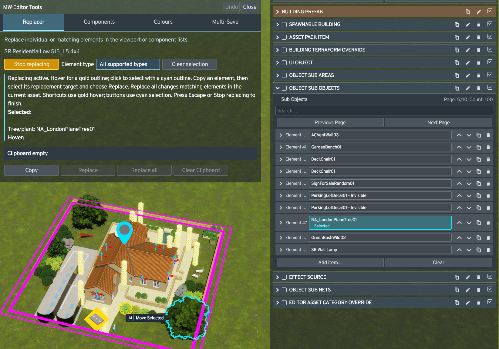
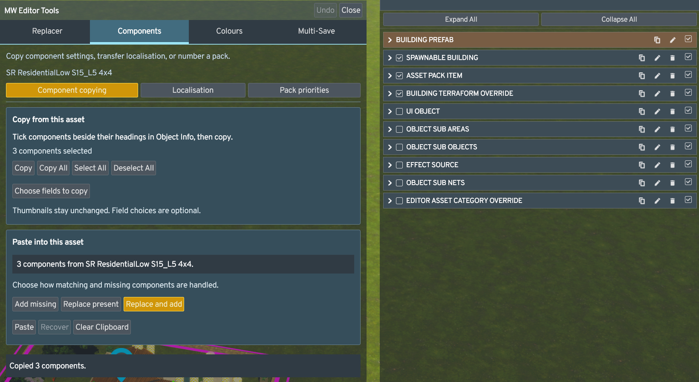
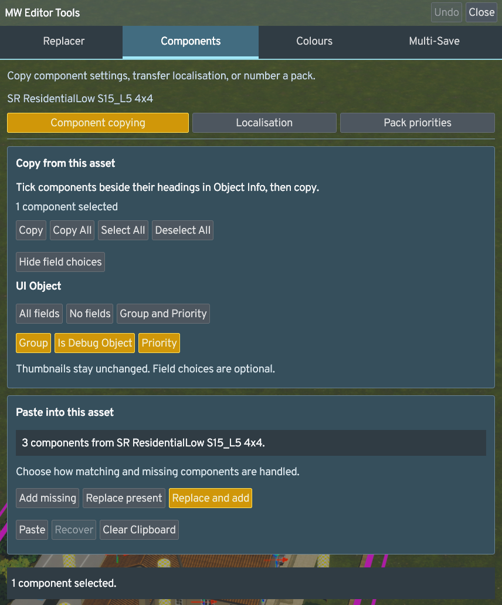
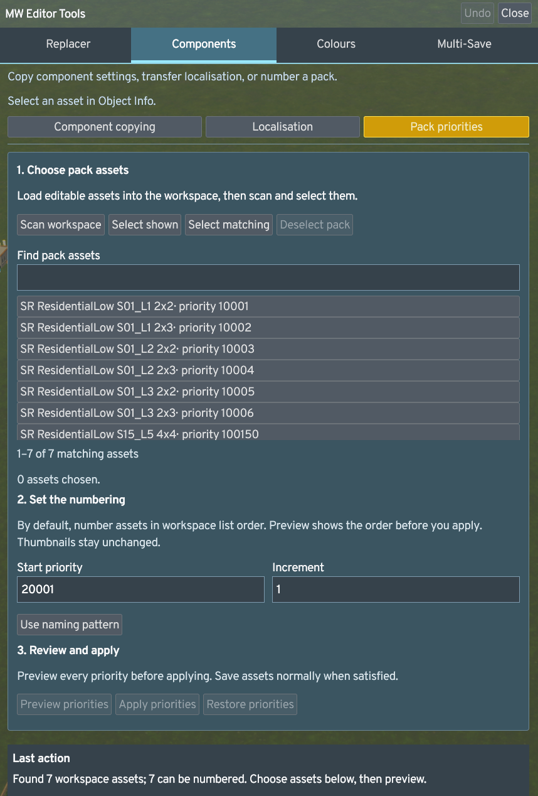
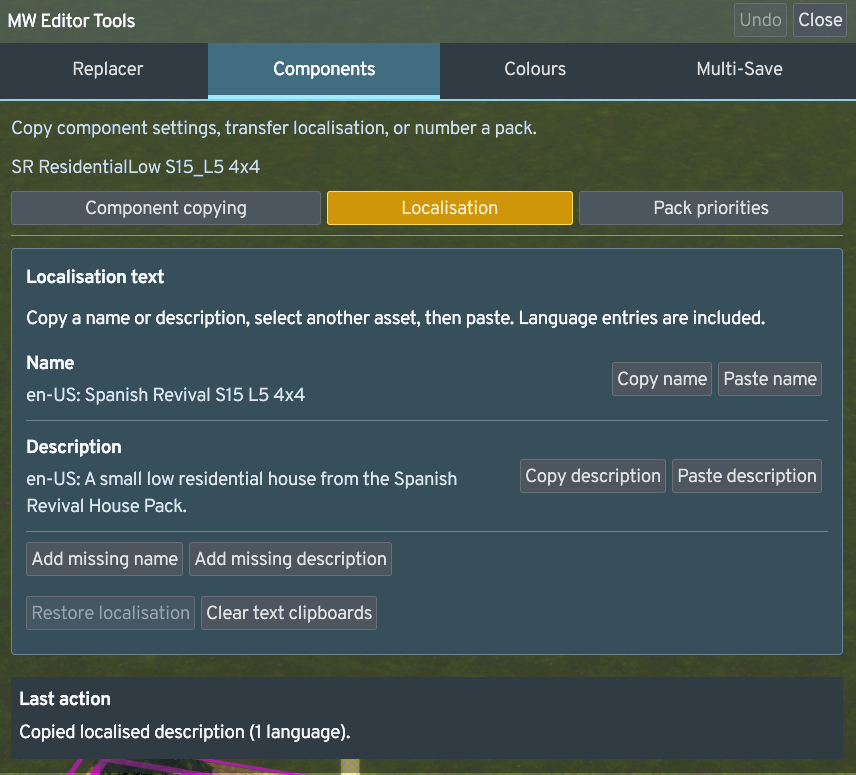
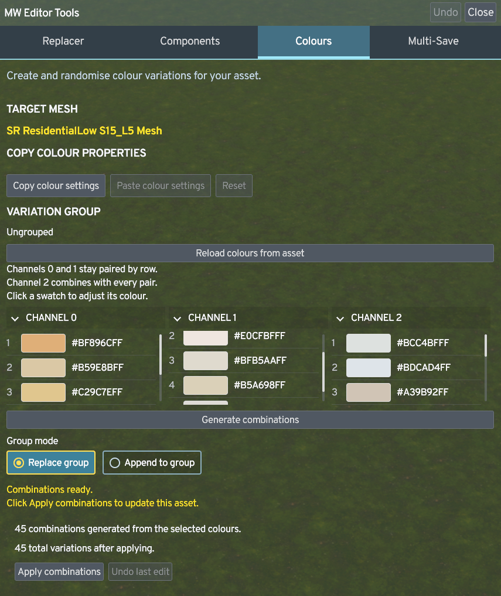
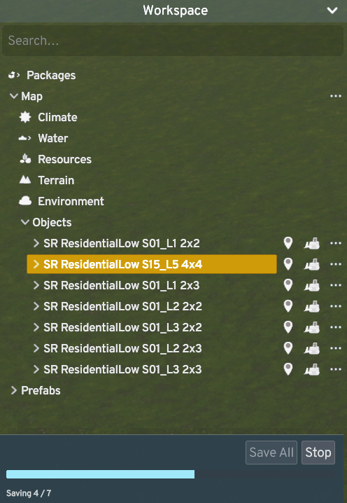

# MW Editor Tools — User Manual

Version **0.4.254** · Cities: Skylines II Asset Editor

MW Editor Tools combines element replacement, component transfer, colour variations, workspace saving and supported Undo in one window.

## Contents

- [Install or update](#install-or-update)
- [Open the window](#open-the-window)
- [Quick start](#quick-start)
- [Undo](#undo)
- [Replacer](#replacer)
- [Components](#components)
- [Colours](#colours)
- [Multi-Save](#multi-save)
- [Options and shortcuts](#options-and-shortcuts)
- [Troubleshooting](#troubleshooting)
- [Supported limits](#supported-limits)
- [Screenshot guide](#screenshot-guide)

## Install or update

Download the installer or manual ZIP from the [0.4.254 release](https://github.com/Macwelshman/MW-Editor-Tools/releases/tag/v0.4.254). The repository contains development source; cloning it does not install the mod.

### Windows installer

Close Cities: Skylines II, run **MWEditorTools-0.4.254-Setup.exe**, and choose **Install / update**. The default is your current Windows user's Mods folder; no administrator privileges are needed there. Use **Choose folder…** only for another user Mods folder. The installer refuses the game installation and linked folders.

The installer verifies its embedded files, backs up the entire existing mod folder, and verifies every installed file. Backups are outside Mods, under **Cities Skylines II/MWEditorTools-backups** in the user data folder. The completion message gives the exact path. The installer does not change settings stored outside the mod folder. It is unsigned and requires .NET Framework 4.8.

If a write fails while the game stays closed, changed files are rolled back. If the game starts during installation, all further writes, including rollback, stop: close the game before restoring the displayed backup or running the installer again.

### Manual ZIP installation

1. Fully close Cities: Skylines II.
2. If updating, back up the existing `MWEditorTools` mod folder.
3. Place these four files in `%USERPROFILE%\AppData\LocalLow\Colossal Order\Cities Skylines II\Mods\MWEditorTools`:
   - `MW.EditorTools.dll`
   - `MW.EditorTools.mjs`
   - `MW.EditorTools.css`
   - `0Harmony.dll`
4. Start the game and open the Asset Editor.

Keep the supplied third-party notices with the package. Do not place these files in the game installation or replace game assemblies. If the package has a SHA256 manifest, use it to verify the files.

To roll back, fully close the game and restore the previous mod folder. This restores the mod version; it does not reverse changes already saved to an asset.

## Open the window

Click the **MW Editor Tools** coloured diamond icon in the Asset Editor. The window has four tabs:

| Tab | Purpose |
|---|---|
| Replacer | Replace one element or all matching elements in an asset list. |
| Components | Copy components and their settings between assets. |
| Colours | Edit palettes and generate colour variations. |
| Multi-Save | Save unlocked assets in the workspace. |

**Undo** is in the window header and is also available through Ctrl+Z. It does not need a separate tab. The icon stays visible while the window is open. Click it again to close the window. It starts at the top-left beside the editor sidebar and shifts right to avoid other launcher icons.

Drag the window by its header to move it. Its position is remembered. Use **Options → MW Editor Tools → Reset window position** if needed. Hover over controls for explanations; the component transfer report stays visible and **Details** opens save reports.

Most tools follow the asset or mesh selected in the native **Object Info** panel. Select an editable asset to populate the controls. Read-only assets require an editable copy before changes can be applied.

## Quick start

| Task | Workflow |
|---|---|
| Replace an element | Hover source → Ctrl+C → hover destination → Ctrl+V. |
| Replace matching elements | Hover source → Ctrl+C → hover destination → Ctrl+Shift+V. |
| Copy one component | Tick components in Object Info → Components → Copy → select destination → Paste. |
| Copy all components | Components → Copy All → select destination → choose mode → Paste. |
| Change colour variations | Colours → select mesh → adjust palette → Generate combinations → Apply combinations. |
| Save workspace assets | Workspace → Save All → review the result. |
| Undo a supported replacement, move or deletion | Ctrl+Z, or Undo in the header. |

Use an editable copy when trying an unfamiliar workflow. Clipboard contents and recovery controls are working-session tools, not saved backups.

## Undo

Undo captures the last supported completed action when **Enable Undo** is on. Press **Ctrl+Z** or click **Undo** in the window header. The Object Info Undo section starts collapsed; expand it to show its controls.

There is one shared last-action slot:

- A new supported completed action replaces the previous action.
- A cancelled or unchanged move preserves the previous action.
- Successful Undo consumes the action. Pressing Undo again does not walk back through older edits.
- Loads, unrelated edits and selecting an unrelated asset can clear the action. Component paste also clears the shared slot.
- The Undo slot does not survive a reload. Saving and reopening preserves the resulting asset changes, not the recovery slot.

### Supported actions

| Element | Supported Undo |
|---|---|
| Attached-element replacement | The last single or batch replacement, restored as one action. |
| Props, foliage and supported nested groups | Supported standalone/bound deletion and built-in moves. |
| Surfaces and areas | Supported bound/unbound deletion and native node edits on existing supported polygons. |
| Native editor effects | Supported direct bound/unbound deletion and built-in moves. |
| Directly bound lanes/network segments | Supported deletion, subject to ownership and geometry checks. |

“Bound” means an element is attached to an owning asset. Supported recovery preserves its placement and relationships to that asset. The relevant bulldozer mode must target the element: use the native Main, Sub-elements or Everything mode as appropriate. Recovery is conditional on the selected route passing its checks; the table does not promise every possible element arrangement can be restored.

### Surface and area nodes

Keep the relevant surface/area tool active after releasing the node, then press Ctrl+Z.

Adding a node and then moving **that same added node** is treated as one action. Moving a different node starts a separate last action. Deleting one node from an existing supported polygon is also supported.

Whole-polygon creation/deletion through the node tool and edits that merge or affect multiple polygons are outside this workflow.

### Separate recovery controls

| Control | Recovers |
|---|---|
| Header Undo / Ctrl+Z | The last supported replacement, move, deletion or node edit. |
| Components → Recover | The destination settings/components before the latest component paste. |
| Colours → Undo last edit | The last supported colour edit. |


## Replacer

Replacer copies an element's referenced asset and uses it as a replacement. It preserves the **destination row's placement and settings**, rather than copying the source element's position.

### Copy and replace in the viewport or Object Info

Surface-to-surface and compatible Area-to-Area replacement retain each destination boundary, elevation, settings and live entity references. They can be replaced individually or with Replace all, then restored with Undo. Each source row must map uniquely to its live boundary. Area navigation/activity markers can change while existing companion lane references and path-method settings are retained. Unknown layout changes, surface-to-area conversions and nested owners are refused. Surface/area compatibility is deliberately narrow: two Area entries can still be incompatible. Refused layout conversions do not change the asset. The earlier surface material/rebuild path has managed checks, but a fresh dedicated visual, repeated rebuild and save/reopen acceptance is not established by the latest general replacement test.

For filtered viewport selection, click **Replacer → Start replacing** while native Select is active and an editable asset is inspected. This immediately enables viewport selection; no separate targeting step is needed. Choose an element type to filter what can be selected. Starting does not modify the asset. Eligible mesh outlines show gold on hover and cyan for MW selection, with no added circles. Surfaces, areas and networks also use polygon/curve outlines. Native effect/marker gizmos may retain the game colour; the panel reports when no eligible mesh outline is available. Panel Copy, Replace and Replace all use the clicked cyan selection. Viewport Ctrl+C, Ctrl+V and Ctrl+Shift+V use the current gold hover, even when a different element remains selected. Shortcuts refuse if the ray is blocked by UI or the hover has changed; panel buttons require a clicked selection. Surface hits are checked against the polygon boundary. Clear selection removes only the target; Stop replacing or Escape returns to native Select. Use native Select and the normal tool for moving/deleting. Changing a value in vanilla Object Info automatically stops replacing and clears its selection and outlines before the native rebuild. Click Start replacing again when the edit has finished.

A clicked viewport selection also marks its exact Object Info element row with a rounded cyan box. Selecting an element opens its owning component and list, moves to the matching page and scrolls the row into view. Search filters remain unchanged; if a search excludes the selected row, clear that search to reveal it. Component-copy checkboxes are independent.

The panel explains Undo eligibility for the target. A candidate or successful data preflight still needs the normal capture, source, companion and reference checks when an action occurs. Extra mod data, including Anarchy protection, may prevent capture. Filter/asset changes and stale targets clear the selection. Fine filters can reject the nearest overlapping static object; they do not guarantee selection through it.

1. Use the native default selection tool for viewport targeting.
2. Hover over the source element in the viewport, or its highlighted row in the current asset's **Object Info attached-element list**.
3. Press **Ctrl+C** while it is highlighted. Check the Replacer clipboard to confirm what was copied.
4. Hover over the destination element or its Object Info row.
5. Press **Ctrl+V** to replace that element.

Object Info rows often expand or collapse rather than becoming a persistent selection. You can copy and replace while hovering; clicking the row first is not required.

The Object Info attached-element list is different from the asset catalogue/browser used to find prefabs. These hover instructions refer to attached source-list elements, not copying an arbitrary catalogue card.

### Batch replacement

After copying a source element, hover over a destination and press **Ctrl+Shift+V**. This replaces all elements matching the destination's original reference **in that owning asset list**. It does not perform a workspace-wide search, and it does not mean replacing every nested occurrence throughout unrelated lists.

For example, copy a flower bush, hover over one of several matching destination bushes and use Ctrl+Shift+V. Matching rows in that asset list receive the copied bush reference while keeping their individual placements/settings.

### Use the Replacer tab

When supported rows are available, you can choose one in the tab and use **Copy**, **Replace** or **Replace all**. **Clear Clipboard** empties the element clipboard and is disabled when empty. The clipboard helps identify the source even when you move the cursor away from it.

Objects must be replaced with compatible object rows, effects with effect rows, and so on. Copying a prop that contains an effect copies the prop reference; copying the effect itself copies an effect reference. They are different element types.

### Undo a replacement

Press **Ctrl+Z**, or click **Undo** in the shared window header, to restore the last single replacement or the entire last batch. Original prefab references, row order, placement and settings are restored together. Props already using the replacement before the batch are left as they were.

Keep **Enable Undo** on. After foliage replacement, wait for regeneration to finish before Undo becomes available. Native regeneration may clear the inspector or select the replacement prefab; this does not discard replacement Undo. A newer action, an unrelated edit, selecting an unrelated asset or reloading can clear the slot. Successful Undo consumes it; there is no Redo.

### Replacement limits

The destination must resolve to a unique supported source row and owning asset. Standalone destination placements without an editable attached source list are not supported. Read-only, ambiguous, incompatible or still-updating targets can be refused.

A replacement whose visible result or status is wrong should not be saved over an original. For a reported foliage regeneration failure, stop further replacements and reload the disposable session without saving; a queued rollback is not a guarantee that every visible/native state has already recovered.

## Components

Components transfers the selected components' settings between assets. It leaves the source unchanged and attaches additions to the destination asset.

Choose **Component copying**, **Localisation** or **Pack priorities** at the top of the tab to show that task's controls. A workspace scan reports how many assets were found; load assets into the editor workspace if it reports none.

### Copy one or several components

1. Select the source asset in Object Info.
2. Tick the selection checkbox beside each component heading, or choose **Select All** in the Components tab. Use **Deselect All** to clear the checkmarks.
3. Open **Components** in MW Editor Tools and choose **Copy** to copy the checked components, or **Copy All** to copy every supported attached component.
4. Select the destination asset and open **Components** in MW Editor Tools.
5. Choose a paste mode and click **Paste**.

The Components tab shows the clipboard, paste modes, **Paste**, **Recover**, and the result information. Paste checks compatibility automatically before applying supported changes. The report below stays visible and lists changes or skipped components. Selecting another asset clears the prior result information; there is no separate Preview step or duplicate component list.

Selection uses the game's native small editor checkbox. The heading arrow still expands/collapses its settings; its existing activation checkbox still controls whether the component is active. Selection checkboxes are separate from activation. The component selection checkboxes do not select viewport elements.

### Copy selected fields

After ticking the source component heading, use **Choose fields to copy**. Included fields are highlighted. Use **All fields**, **No fields**, or the UI Object **Group and Priority** preset, then adjust individual fields and click **Copy**. Choices apply to that source selection; selecting another asset starts with its default field choices.

UI Object **Icon** is always excluded from component copying, so each destination keeps its thumbnail. On a newly added component, unselected fields keep the defaults chosen by the game. Other opaque/private/native or otherwise unsupported settings can still cause a component to be skipped; this is not universal copying of arbitrary data.

### Number pack priorities

1. Load editable assets into the workspace and open **Components → Pack priorities**.
2. Click **Scan workspace**, filter to the desired pack and choose its assets. **Select shown** selects eligible assets on the current page; **Select matching** selects all eligible search matches across pages. **Deselect pack** clears the selection.
3. Set **Start priority** and a positive **Increment**.
4. Click **Preview priorities**. By default, assets follow workspace list order. If **Use naming pattern** is enabled, the supplied pattern sorts by pack, asset number, level, plot width and depth. Every selected variant gets its own priority.
5. Review every asset and assigned value, then click **Apply priorities**. Changing choices or inputs requires another preview. **Restore priorities** returns the last batch if the assets have not changed since.
6. Save assets normally or through Multi-Save when satisfied. Numbering does not save automatically.

Only loaded workspace assets are considered. Read-only assets and assets without UI Object are unavailable. Default numbering follows the workspace list order and accepts any naming format. Enable **Use naming pattern** only when you want names to determine the order. With it enabled, every selected name must match; an unmatched name refuses preview. Thumbnails, Group and other component values stay unchanged.

The default format is `AB ZoneType_01_L1_2x2`. The named sections tell the sorter what to read: `pack` = AB (pack initials), `zone` = ZoneType, `house` = 01 (asset number), `level` = 1, `width` = 2 and `depth` = 2. These are labels, not literal words to put in names. `\d+` reads one or more digits; `[1-5]` allows levels 1–5. Spaces, underscores, `L` and `x` must match. `^` and `$` anchor the whole name. The pattern sorts by pack, asset number, level, width, then depth; zone is recognised but is not a sort key.

Example with start **100** and increment **1**:

| Asset | Priority |
|---|---:|
| AB ZoneType_01_L1_2x2 | 100 |
| AB ZoneType_01_L1_2x3 | 101 |
| AB ZoneType_01_L2_2x2 | 102 |
| AB ZoneType_02_L1_2x2 | 103 |

Priority asset and preview lists show 25 entries per page, with separate search and page controls. Applying affects the complete prepared preview, including entries hidden by search or on other pages.

The naming pattern uses a four-line field. Use **Reset to default** beside the enabled pattern to restore the supplied expression. Preview again afterwards. Reset does not change whether pattern sorting is enabled. Disable the pattern to return to workspace list order.

### Copy localised text

Use **Copy name** / **Paste name** or **Copy description** / **Paste description** to transfer only that kind of text between the current Object Info assets. These use separate clipboards and include nonblank source language entries. Matching languages are updated; destination-only languages and the other kind of text remain. Internal asset names and thumbnails stay unchanged.

The clipboards show copied text and language IDs. To fill an empty entry on the current asset, open **Add missing name** or **Add missing description**, enter its language ID (for example `en-US`) and text, then click **Add name** or **Add description**. Existing nonempty entries are preserved. Use Copy afterwards to transfer the new text.

**Restore localisation** returns the latest destination's prior text if later changes do not prevent it. **Clear text clipboards** clears both text clipboards and that Restore entry. Save the asset normally or with Multi-Save to persist translations. A fresh dedicated save/reopen check of localisation is not included in the latest general replacement acceptance.

### Paste modes

| Mode | Already present on destination | Missing from destination |
|---|---|---|
| Add missing | Leave unchanged. | Add with copied settings. |
| Replace present | Replace settings. | Skip. |
| Replace and add | Replace settings. | Add with copied settings. |

Destination-only components remain in every mode. Existing components retain their active/inactive state; added components retain the copied source activation.

Settings include supported nested lists, arrays, curves and referenced prefabs. Mutable settings are copied independently. Referenced prefabs retain their identities: transfer does not duplicate the referenced assets or remap them to similarly named assets.

Dependencies are checked and copied additions are ordered where possible. A required active dependency must already be available or be included as a suitable copied addition. Incompatible components and settings that cannot be safely copied are reported as skips. **Copy all** does not override those restrictions or silently substitute default settings.

### Recover a component paste

Return to the latest destination and click **Recover**. This reinstates the prior settings and removes tracked additions from that paste.

Recover is one level, not a history of every paste. It refuses if the destination has changed since the paste, to protect subsequent work. Every Paste checks the current destination, clipboard and settings again.

The result and skipped-component report remain visible below the controls. **Clear Clipboard** empties the component clipboard and is disabled when empty. The component clipboard is separate from Replacer's element clipboard and the Colours clipboard.

## Colours

Colours follows the object or render mesh selected in Object Info. If the asset has several meshes, choose the target mesh in the tab.

### Edit and generate variations

1. Select the target mesh and variation group. Use **Previous group** or **Next group** where available.
2. Use **Reload colours from asset** to load the selected group's current colours. This replaces uncommitted palette edits and clears generated combinations; it does not modify the asset by itself.
3. Click a swatch in Channel 0, 1 or 2 to open the colour picker. Adjust it, then choose **Use colour**.
4. Choose **Replace group** or **Append to group**.
5. Click **Generate combinations**, then inspect the result/count.
6. Click **Apply combinations** to write the variations.

Channels **0 and 1 remain paired by row**. Channel **2 combines with every pair**. For example, four paired rows and three Channel 2 entries produce twelve combinations. Changing the palette after generation requires generating again before applying.

**Replace group** replaces the selected group's variations. **Append to group** adds the generated variations to it. This tool creates combinations from your palettes; it does not promise that every unrelated colour setting on an asset is randomly regenerated.

### Transfer colour settings

1. Select the source mesh and choose **Copy colour settings**.
2. Select the destination mesh and choose **Paste colour settings**.
3. Paste applies immediately. Choose **Reset** beside Paste to restore that mesh’s settings from before its last paste. Later edits prevent reset.

Paste replaces the complete supported Colour Properties setup, or adds Colour Properties where supported. **Undo last edit** is the Colours tool's own recovery control.

If you change selection with uncommitted edits, the tool asks before discarding the draft. Return to the previous item to continue editing, or explicitly discard and follow the new selection. Read-only assets and busy editor operations can disable writing controls.

## Multi-Save

Multi-Save saves unlocked assets in the current workspace, including hidden entries. Repeated instances of the same asset are saved once. Locked assets are excluded.

1. Check the number ready to save at the bottom of **Workspace**.
2. Click **Save All** there.
3. Follow any native editor dialogs that require a response. The progress bar appears below Save All in Workspace while saving.
4. Review the completion summary. Open the **Multi-Save** tab and **Details** for the report or any skipped/failed items.

Existing files are updated. New assets use their current names. This is workspace saving, not automatic creation of backup copies.

**Stop** requests that the batch stop after the current asset finishes. It does not reverse files already saved. Failures expand the detailed report automatically. If no assets are eligible, Save is disabled.

## Options and shortcuts

Open **Options → MW Editor Tools**. Edit the options, then choose **Apply changes** to activate and save them.

| Option | Purpose |
|---|---|
| Confirm deletions | Confirm component removal and clearing lists. This is not a confirmation for every bulldozer action. |
| Enable Undo | Capture supported recoverable actions. Changing this clears the current Undo action. |
| Show inspector Undo | Show the Undo control in Object Info. |
| Enable hide UI shortcut | Enable the native hide/show UI toggle in the Asset Editor. |
| Hide / show UI shortcut | Default Backquote (`). Press a single key (for example Home or F8) or a key combination, then Apply changes. Press again or Escape to restore the UI. |
| Enable Undo shortcut | Enable the configured Undo key combination. |
| Undo shortcut | Default Ctrl+Z. Click the binding field and press the desired combination. |
| Reset window position | Return the shared tools window to its default location. |
| Enable browser shortcuts | Enable the category shortcuts below. Off by default. |

### Replacer shortcuts

With **Start replacing** active, viewport shortcuts use the current gold hover. Panel buttons use the clicked cyan selection. Object Info row shortcuts use the hovered attached-element row.

| Shortcut | Action |
|---|---|
| Ctrl+C | Copy the hovered compatible element reference. |
| Ctrl+V | Replace the hovered destination. |
| Ctrl+Shift+V | Replace matching elements in its owning asset list. |
| Escape | Stop replacing and return to native Select. |

### Browser defaults

| Shortcut | Category |
|---|---|
| Alt+B | Buildings |
| Alt+D | Props |
| Alt+F | Foliage |
| Alt+A | Areas |
| Alt+E | Effects |
| Alt+S | Surfaces |

The category shortcut opens the browser at that category and retains its search text. A retained search can still filter the displayed items.

Previous default Ctrl+Alt bindings migrate to these defaults. Other customised bindings are preserved. Duplicate combinations with other enabled MW shortcuts are suppressed; choose distinct bindings and Apply changes. Undo and browser bindings use a letter A–Z with the recorded modifiers. Hide / show UI also accepts standalone named keys such as Backquote, Home and F1–F12.

Shortcuts pause while typing, recording a binding, using dialogs, saving or recovering. Modifier combinations must match exactly: holding an extra modifier can prevent a shortcut from firing.

## Troubleshooting

The earlier 0.4.173 fix corrects a launcher layout loop that could leave the game UI blank after using **TAB** to open the developer menu. Closing that menu with TAB should restore the normal UI. If it happens again, keep the UI log for diagnosis.

Confirmed component removal now refreshes the edited prefab and inspector after the dialog. This includes removing an Effects component copied onto an imported asset. Whole-component removal is not covered by the shared Undo; cancel the dialog to retain it. Effects belonging to other components or nested props are separate.


| Symptom | What to check |
|---|---|
| Empty tab or disabled controls | Select a supported editable asset or mesh in Object Info. Wait for loading/saving/recovery or dialogs to finish. |
| Ctrl+C copies the wrong thing | Check Replacer's clipboard. Hover the intended prop or effect itself; a prop containing an effect and the effect are different targets. |
| “Does not match copied element type or an owned source row” | Source and target must be compatible row types, and the target must have a supported unique owner/source row. Try the corresponding Object Info row. Do not force a mismatched paste. |
| Browser shortcut does nothing | Enable browser shortcuts and Apply changes. Check custom/conflicting bindings, typing focus and exact modifiers. |
| Browser category looks empty | Check the browser's retained search text. |
| Undo is disabled or does nothing | Check Enable Undo/shortcut options and supported scope. The slot may have been consumed, cleared or replaced. Close typing/dialog focus. |
| Area/surface node Undo does not trigger | Complete/release the node edit, keep its native area/surface tool active, then use Ctrl+Z. |
| Component Paste is refused | Check the report, select an editable destination and try Paste again. Compatibility is checked on every paste. |
| Component is skipped | Review the report below the controls for compatibility, dependencies or unsupported settings. An editable destination alone does not make every component transferable. |
| Recover refuses | A later destination edit, identity change or different destination prevents safe restoration. |
| Colours asks to generate again | The palette changed after the last generation. Generate combinations again before Apply. |
| Save is disabled or some assets were excluded | Check the ready count and Details. Locked assets are excluded; saving may already be running. |
| Window is out of reach | Use Options → MW Editor Tools → Reset window position. |

Viewport targeting requires a current native highlight and an exact source match. Use the default selection tool, keep the cursor over an uncovered element and wait for regeneration before retrying. Ambiguous source matches remain refused.

For a reproducible problem, record the mod version, source/target names, tool and action sequence, and any displayed message. The mod log is normally at:

```text
%USERPROFILE%\AppData\LocalLow\Colossal Order\Cities Skylines II\Logs\MWEditorTools.log
```

Include whether the issue persists on a fresh disposable copy. Avoid saving a visibly failed operation over the original asset.

### Other editor mods

Move It moves and Better Bulldozer custom deletions are outside MW's advertised native-tool Undo coverage. Their histories are separate. Anarchy protection or other extra component data can cause a target to be refused. Startup coexistence does not establish recovery compatibility for every operation.

The optional Asset Icon Creator integration preserves supported Group/Priority settings during its verified thumbnail callback. A different or unsupported version can disable the adapter; check the mod log. Component copying always excludes UI Object Icon so destination thumbnails stay unchanged.

## Supported limits

The current release does **not** provide:

- Redo or multiple-action Undo history.
- Whole-building or whole-component recovery through the shared Undo slot.
- Network moves, standalone network/junction recovery or guaranteed third-party-tool recovery.
- Whole-polygon creation/deletion through node tools, multi-polygon edits or merged-edit recovery.
- Arbitrary standalone viewport destination replacement or a global workspace replacement operation.
- Universal component copying: opaque/private serialized payloads, native/runtime objects, unsupported third-party components and oversized/cyclic settings can be skipped.
- Undo of files already written by Multi-Save.

For release scope and validation details, see [release readiness](https://github.com/Macwelshman/MW-Editor-Tools/blob/main/docs/RELEASE_READINESS_0.4.254.md). For a shorter overview, return to the [README](https://github.com/Macwelshman/MW-Editor-Tools/blob/main/README.md).

## Screenshot guide

These in-game screenshots show the interface described in this manual. Example asset names and settings are illustrative; enabled buttons depend on the current selection and clipboard.

### Replacer and exact row selection



### Component copying



### Choose fields to copy



### Pack priorities



### Localisation text



### Colour variations



### Workspace Multi-Save



### Options and shortcuts


